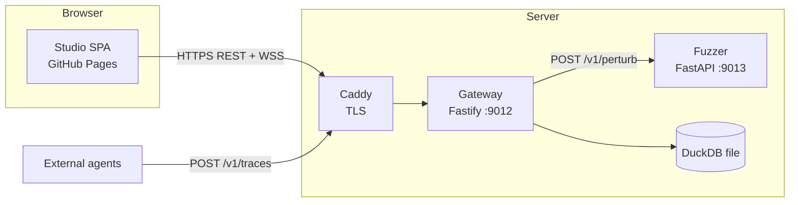
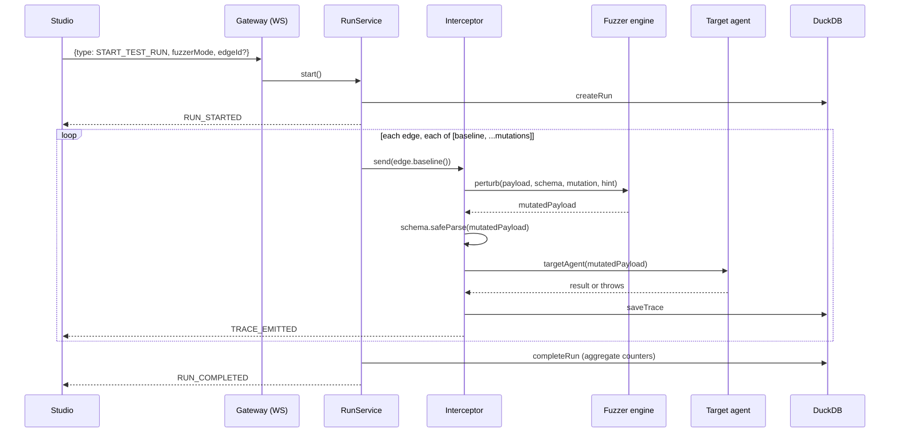
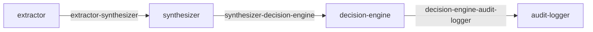
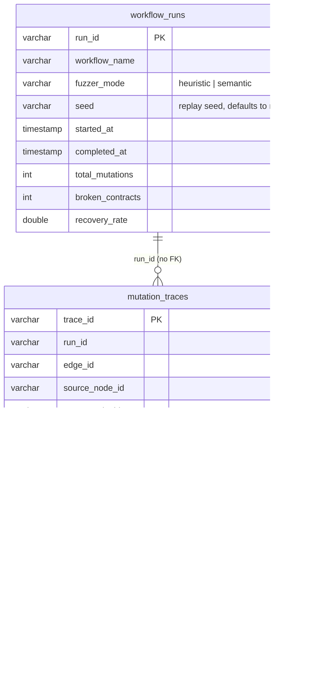

# Architecture

## Components



- The **gateway** owns contracts, run orchestration, persistence and telemetry fan-out.
- The **fuzzer** is optional. If it is down or errors, the gateway falls back to its own deterministic heuristic fuzzer and marks the trace `fuzzerFallback: true`.
- The **studio** is a static site. It talks only to the gateway.

## A test run, end to end



Only one run can be active at a time. A second `START_TEST_RUN` returns `RUN_IN_PROGRESS` (HTTP 409 semantics; over the socket it arrives as an `ERROR` frame).

## Topology (sample workflow)



| Edge | Contract (strict: unknown keys are violations) |
| --- | --- |
| `extractor-synthesizer` | `claim_id` non-empty string; `fields` non-empty `string[]`; `confidence` number in [0, 1] |
| `synthesizer-decision-engine` | `confidence` number in [0, 1]; `decision` `"APPROVE" \| "REJECT"`; `risk_score` integer |
| `decision-engine-audit-logger` | `claim_id` non-empty string; `decision` `"APPROVE" \| "REJECT"`; `risk_score` integer; `signed` boolean |

The studio keeps a hand-maintained copy of this topology in `studio/src/lib/topology.ts` because the gateway exposes no topology route. The two must be kept in sync.

## Data model (DuckDB)



There is no foreign key by design: DuckDB rejects updates to a parent row that has children, and `completeRun` updates `workflow_runs`. Indexes exist on `run_id` and `edge_id`. Migrations live in `gateway/migrations/` as `NNN_name.up.sql` / `.down.sql`.

## HTTP API

| Method | Path | Auth | Purpose |
| --- | --- | --- | --- |
| GET | `/health` | public | `healthy`, `degraded` (fuzzer down, still 200) or `unhealthy` (DuckDB down, 503) |
| GET | `/openapi.json` | public | OpenAPI document |
| GET | `/v1/auth/status` | public | `{ required, methods: { github, password } }` |
| POST | `/v1/auth/login` | public | Password login (only if `AUTH_PASSWORD` set): `{ password }` returns `{ token, expiresAt, tokenType }` |
| GET | `/v1/auth/github/login` | public | Redirects to GitHub (only if GitHub configured) |
| GET | `/v1/auth/github/callback` | public | OAuth callback; redirects to the studio with `login_code` or `login_error` |
| POST | `/v1/auth/exchange` | public | `{ code }` returns `{ token, expiresAt, tokenType, user }` |
| POST | `/v1/auth/ws-ticket` | bearer | 30 s ticket for the WebSocket |
| POST | `/v1/traces` | bearer | Ingest an externally produced payload, validate it, store and broadcast |
| GET | `/v1/traces?runId&edgeId&limit` | bearer | List traces, newest first (limit 1–1000, default 500) |
| GET | `/v1/runs` | bearer | Up to 50 runs with per-edge summaries |
| WS | `/v1/telemetry?ticket=` | ticket | Live frames and run control |

Errors use `{ "error": { "code", "message", "details?" } }`. Codes: `VALIDATION_ERROR`, `UNKNOWN_EDGE`, `UNAUTHORIZED`, `RATE_LIMITED`, `NOT_FOUND`, `RUN_IN_PROGRESS`, `SERVICE_UNAVAILABLE`, `INTERNAL_ERROR`.

## WebSocket protocol

Client to server (one action):

```json
{ "type": "START_TEST_RUN", "fuzzerMode": "heuristic" | "semantic", "edgeId": "optional", "seed": "optional" }
```

Server to client:

| Frame | Payload |
| --- | --- |
| `RUN_STARTED` | `runId`, `summary: { fuzzerMode, edgeId?, seed? }` |
| `TRACE_EMITTED` | `runId`, full `trace` |
| `RUN_COMPLETED` | `runId`, `summary: { totalTraces }` |
| `ERROR` | `error: { code, message }` |

Frames are broadcast to every connected client. The server pings every 30 s and drops dead sockets.

## Ingest vs. interception

`POST /v1/traces` lets an external agent report a payload it actually sent. The gateway validates it against the edge schema, derives the status with `handled = true`, and stores `durationMs = 0`. A `mutation` block may declare the mutation type and original payload; otherwise the trace is `mutationType: "NONE"`. Ingest cannot observe the downstream agent, so it can never produce `FAILED`.
