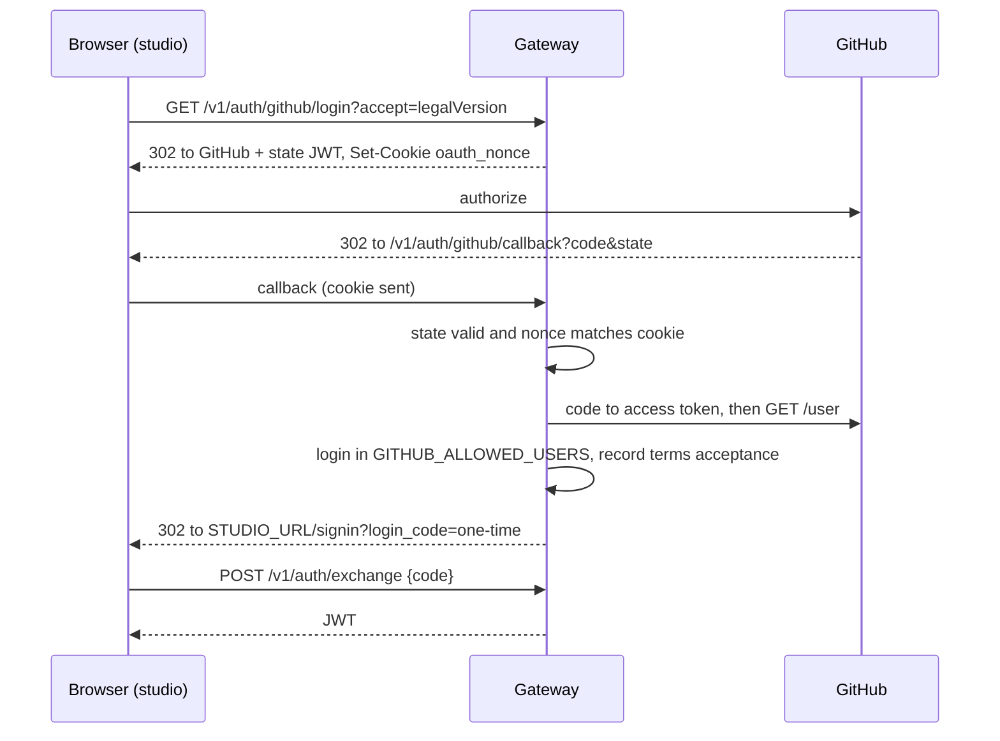

# Gateway

Fastify 5 + TypeScript (ESM). Entry point `src/server.ts`; `buildServer()` is exported for tests, `main()` runs when the file is the entry module or when started under pm2 (`pm_id` is set).

## Source map

| Path | Role |
| --- | --- |
| `src/config.ts` | Environment parsing (`loadConfig`), auth config validation |
| `src/context.ts` | `AppContext` handed to every route plugin |
| `src/errors.ts` | `AppError`, `ErrorCode`, `errorBody()` |
| `src/auth.ts` | `AuthService` (JWT via `jose`), `authHook` |
| `src/contracts/schemas.ts` | Agents, edges, Zod contracts, `toViolations()` |
| `src/contracts/interceptor.ts` | `ContractProxyInterceptor`, trace type, `deriveDownstreamStatus()` |
| `src/fuzzers/heuristic.ts` | Deterministic/seedable in-process fuzzer |
| `src/fuzzers/semantic.ts` | HTTP client for the Python fuzzer with heuristic fallback |
| `src/agents/sample-run.ts` | Demo agents and the run loop |
| `src/services/run-service.ts` | Demo run lifecycle, persistence, broadcasting (per owner) |
| `src/services/project-run-service.ts` | Assistant-driven runs: plan cases, hand them out one by one, record reported results |
| `src/contracts/registry.ts` | `ContractRegistry`: Ajv-compiled JSON Schema contracts for user projects |
| `src/contracts/demo.ts` | JSON Schema form of the demo edges, `DEMO_PROJECT_ID` |
| `src/device.ts` | In-memory device-code flow for MCP sign-in |
| `src/storage/{projects,tokens}.ts` | Project and MCP token repositories |
| `src/services/broadcaster.ts` | WebSocket client set, heartbeat |
| `src/storage/duckdb.ts` | `TraceStore` interface and DuckDB implementation |
| `src/storage/migrate.ts` | SQL migration runner (`up` / `down`) |
| `src/routes/*.ts` | `auth`, `health`, `traces`, `telemetry`, `projects`, `device`, `access` plugins |

## Contract interception

`createEdgeProxy` wraps a target agent and returns `(payload) => Promise<output>`. Each call:

1. Optionally asks the fuzzer for a mutated payload (`enableAdversarialMutation`, `forcedMutationType`).
2. Validates the delivered payload against the edge schema with `safeParse`, collecting violations as `{ path, code, message }`.
3. Calls the target agent with the delivered payload **regardless of validity**. The harness measures resilience, so it never blocks bad input.
4. In `finally`, builds the `TraceRecord`, appends it, and awaits all listeners with `Promise.allSettled` (a failing listener cannot break the run).
5. Re-throws any agent error to the caller, after recording it.

### Status derivation

```ts
if (!handled) return "FAILED";
if (mutationType !== "NONE" && !contractViolated) return "BYPASSED";
return "HANDLED";
```

`BYPASSED` means the fuzzer changed the payload but the contract still accepted it: a gap in the contract, not in the agent.

## Fuzzer engines

Both implement `FuzzerEngine.perturb(payload, schema, mutationHint?, context?)`.

### Heuristic

Works on a deep copy of an object payload (non-objects, arrays and empty objects return `mutationType: "NONE"`). It picks one key uniformly at random, then applies the mutation:

| Mutation | Effect on the chosen key |
| --- | --- |
| `KEY_OMISSION` | delete the key |
| `TYPE_SWAP` | number to its string form; string to `404`; boolean to `0`/`1`; anything else to `null` |
| `BOUNDARY_OVERFLOW` | set to `Number.MAX_SAFE_INTEGER + 1000` (about 2^53) |
| `SEMANTIC_DRIFT` | strings only: `"[Ambiguous status] <value> (eval: unknown)"`; non-strings are left unchanged |

The random source is injectable (`new HeuristicFuzzer(rng)`), which makes tests deterministic. If no mutation is forced, one is chosen uniformly from the four.

### Semantic

Maps the mutation hint to a strategy and calls `POST {FUZZER_URL}/v1/perturb` with a 15 s timeout:

| Hint | Strategy |
| --- | --- |
| `TYPE_SWAP` | `INVERT_LOGIC` |
| `SEMANTIC_DRIFT` (default) | `AMBIGUOUS_DRIFT` |
| `KEY_OMISSION` | `HALLUCINATE_CONSTRAINTS` |
| anything else | `AMBIGUOUS_DRIFT` |

Any network error, timeout or non-2xx response falls back to the heuristic fuzzer and sets `fallback: true`. The returned trace always reports `mutationType: "SEMANTIC_DRIFT"` for successful semantic calls, with the strategy name in `strategy`. `health()` probes `GET /health` with a 1.5 s timeout.

## Run orchestration

`RunService.start({ fuzzerMode, edgeId? })`:

- Rejects unknown edges (`UNKNOWN_EDGE`, 422) and concurrent runs (`RUN_IN_PROGRESS`, 409).
- Picks the run **seed** (the request's `seed`, otherwise the new run id), builds fresh fuzzer engines from `createFuzzers(seededRandom(seed))` and stores the seed on the run. Starting a run with an earlier run's seed reproduces the same heuristic key choices.
- Creates the run row, broadcasts `RUN_STARTED`, subscribes a listener that persists and broadcasts every trace.
- Calls `executeSampleRun`, which for each selected edge delivers one **baseline** payload (no mutation) followed by one delivery per mutation in the mode's list:

| Mode | Mutations per edge | Traces per edge | Full run (3 edges) |
| --- | --- | --- | --- |
| `heuristic` | `TYPE_SWAP`, `KEY_OMISSION`, `BOUNDARY_OVERFLOW`, `SEMANTIC_DRIFT` | 5 | 15 |
| `semantic` | `TYPE_SWAP`, `SEMANTIC_DRIFT`, `KEY_OMISSION` | 4 | 12 |

- In `finally`: calls `completeRun` (aggregates counters), broadcasts `RUN_COMPLETED`, clears the active flag. Persistence failures are logged and never abort the run.

### Sample agents

| Edge target | Behaviour |
| --- | --- |
| Synthesizer | Defensive. If `confidence` is not a number or `fields` is not an array, returns a recovery object; otherwise `risk_score = round(85.5 × confidence)`. Never throws. |
| Decision Engine | Throws `TypeError` if `decision` is not `APPROVE`/`REJECT`; if `risk_score` is not a number returns a recovery object. |
| Audit Logger | Fragile. Throws if `claim_id` is not a string, `signed` is not a boolean, or `risk_score` is not a number. |

These three behaviours are what make the sample run produce a mix of `HANDLED`, `BYPASSED`, recovered and `FAILED` outcomes. See [math.md](math.md#expected-outcomes-of-the-sample-run).

## Storage

`DuckDbTraceStore` keeps a single connection and serialises every statement through a promise queue, because the node-api connection is not safe for interleaved statements. `completeRun` computes run aggregates in SQL; `listRuns` joins per-edge aggregates in a second query. Timestamps are formatted with `strftime(... '%Y-%m-%dT%H:%M:%S.%gZ')`. `:memory:` is supported for tests.

DuckDB requires a CPU with AVX2 for recent binaries. The project pins `@duckdb/node-api` to `1.4.5-r.1` so it runs on older CPUs (see [operations.md](operations.md#troubleshooting)).

## Authentication

Disabled unless GitHub sign-in (`GITHUB_CLIENT_ID`) or `AUTH_PASSWORD` is configured. Either one makes `JWT_SECRET` mandatory. When enabled:

- `authHook` (an `onRequest` hook registered after CORS) allows `OPTIONS`, `/health`, `/openapi.json` and the sign-in routes under `/v1/auth/` (`status`, `login`, `exchange`, `github/login`, `github/callback`); everything else needs a valid token or ticket, otherwise `401 UNAUTHORIZED`.
- Tokens are HS256 JWTs with issuer `contract-gateway` and an audience: `api` for REST (TTL `JWT_TTL_SECONDS`, default 3600), `telemetry` for WebSocket tickets (30 s) and `oauth-state` for the GitHub round trip (10 min). Audiences are not interchangeable. The subject is the GitHub login (or `studio` for password login).
- Failures from password login and code exchange are counted per client IP in memory: after 5 failures inside a 60 s window the endpoints return `429` with `Retry-After`. A successful login clears the counter. Set `TRUST_PROXY=true` behind a proxy so the real client IP is used.

### GitHub sign-in

Implemented with an OAuth App using the authorization-code flow (`src/github.ts`, `src/routes/auth.ts`). The gateway is the confidential client, so the client secret never reaches the browser.



- **CSRF:** the `state` parameter is a signed JWT containing a random nonce, and the same nonce is set in an `HttpOnly`, `SameSite=Lax` cookie scoped to `/v1/auth/github` (`Secure` when `PUBLIC_URL` is https). The callback requires both to match, so only the browser that started the flow can finish it.
- **Allowlist:** `GITHUB_ALLOWED_USERS` is mandatory when GitHub is enabled; the gateway refuses to start with an empty list. Use `*` to allow any GitHub account (an explicit choice, never the default). Logins are compared case-insensitively.
- **No scopes:** the app requests none; it only reads the public `login` from `GET /user`. The GitHub access token is used once and discarded.
- **One-time code:** the browser is redirected with a random 256-bit code (60 s, single-use, held in memory) instead of the JWT, so tokens never appear in URLs, history or logs.
- **Errors:** failures redirect to the studio's `/signin` page with `login_error=state|denied|github|not_allowed|terms|server`.
- **Terms acceptance:** `/v1/auth/github/login` refuses to start unless `?accept=` equals the configured `LEGAL_VERSION` (`login_error=terms`). The accepted version is signed into the state token, so it cannot be altered in transit, and is stored in `terms_acceptances` (login lower-cased, version, timestamp) once per user and version after an allowed sign-in. Bump `LEGAL_VERSION` when the Terms or Privacy Policy change; everyone then re-accepts at their next sign-in. Sessions that already exist are not interrupted.
- **Profile:** the GitHub login, display name and avatar (only from `avatars.githubusercontent.com`) are carried in the JWT claims. `GET /v1/auth/me` returns them with the session times and the latest accepted Terms version. For password sessions it returns login `studio` and no terms; with auth disabled it returns login `local`.
- Because codes and the failure counter live in process memory, run a single gateway instance (or add shared storage) and expect pending sign-ins to be dropped on restart.

## Tests

`npm test` (Vitest): config parsing, heuristic fuzzer, interceptor, routes, run service (seeded replay, recovery rate), password auth and GitHub sign-in (with a mocked GitHub).
