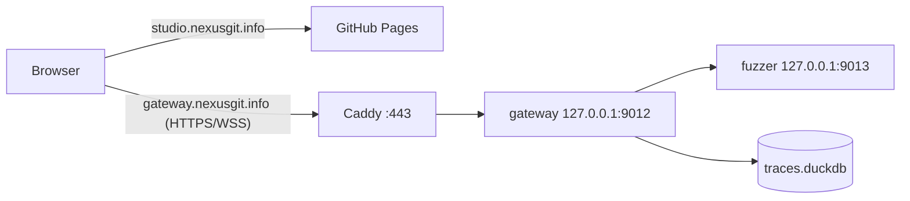

# Operations

## Environment variables

| Variable | Service | Default | Notes |
| --- | --- | --- | --- |
| `PORT` | gateway, fuzzer | 8000 / 8001 | pm2 config uses 9012 / 9013 |
| `HOST` | gateway, fuzzer | `0.0.0.0` | pm2 config binds `127.0.0.1` |
| `DUCKDB_PATH` | gateway | `./data/traces.duckdb` | `:memory:` for tests |
| `FUZZER_URL` | gateway | `http://localhost:8001` | trailing slashes stripped |
| `CORS_ORIGIN` | gateway, fuzzer | localhost only | comma-separated origins, or `*` (do not use in production) |
| `LOG_LEVEL` | gateway | `info` | `silent` disables logging |
| `AUTH_PASSWORD` | gateway | unset | optional shared password (for scripts); unset disables password login |
| `GITHUB_CLIENT_ID`, `GITHUB_CLIENT_SECRET` | gateway | unset | GitHub OAuth App credentials; setting the id enables GitHub sign-in |
| `GITHUB_ALLOWED_USERS` | gateway | unset | comma-separated GitHub logins; required with GitHub sign-in |
| `PUBLIC_URL` | gateway | unset | public gateway URL; the OAuth callback is `PUBLIC_URL/v1/auth/github/callback` |
| `STUDIO_URL` | gateway | unset | studio origin the browser returns to after sign-in |
| `JWT_SECRET` | gateway | unset | at least 32 chars; required when any auth method is enabled |
| `LEGAL_VERSION` | gateway | `1` | version of the Terms and Privacy Policy; bump it when they change so users re-accept at sign-in |
| `JWT_TTL_SECONDS` | gateway | 3600 | integer, minimum 60 |
| `TRUST_PROXY` | gateway | false | set `true` behind Caddy so rate limiting sees client IPs |
| `FUZZER_MODEL_PATH` | fuzzer | `./models/model.gguf` | missing file means mock mode |
| `N_CTX`, `N_GPU_LAYERS` | fuzzer | 4096, -1 | llama.cpp settings |
| `VITE_GATEWAY_URL` | studio (build time) | empty | repo variable for the Pages workflow |
| `GATEWAY_PROXY_URL` | studio dev server | `http://localhost:8000` | |
| `GATEWAY_DOMAIN`, `GATEWAY_UPSTREAM` | Caddy | `gateway.nexusgit.info`, `127.0.0.1:8000` | |

## Local development

```
npm --prefix gateway install && npm --prefix gateway run dev
python -m venv fuzzer/.venv && fuzzer/.venv/bin/pip install -r fuzzer/requirements.txt
(cd fuzzer && .venv/bin/python -m app.main)
npm --prefix studio install && npm --prefix studio run dev
```

Auth is off by default in development. Tests: `npm --prefix gateway test`, `npm --prefix studio test`, `(cd fuzzer && .venv/bin/python -m pytest)`.

## Production topology



- **DNS:** `CNAME studio` to `<github-user>.github.io`; `A`/`AAAA gateway` to the server.
- **Studio:** `.github/workflows/deploy-studio.yml` tests and builds `studio/` on pushes to `main`, copies `index.html` to `404.html`, and publishes. `studio/public/CNAME` pins the custom domain. Pages source must be GitHub Actions.
- **Backend (pm2):** `pm2 start ecosystem.config.cjs && pm2 save`. Secrets and `CORS_ORIGIN` come from the repo-root `.env`, loaded by Node (`--env-file=../.env`, Node 20.6+). Values in the ecosystem file override `.env`.
- **Backend (Docker):** `docker compose -f docker-compose.yml -f docker-compose.prod.yml up -d --build`; requires `JWT_SECRET` and your auth variables in `.env`.
- **GitHub OAuth App:** create one under GitHub Settings, Developer settings, OAuth Apps. Homepage URL is the studio; *Authorization callback URL* must be exactly `<PUBLIC_URL>/v1/auth/github/callback` (for example `https://gateway.nexusgit.info/v1/auth/github/callback`). Put the client id and secret in the server `.env` (never in the repo or the studio build) together with `GITHUB_ALLOWED_USERS`, `PUBLIC_URL` and `STUDIO_URL`. For local development create a second app with callback `http://localhost:8000/v1/auth/github/callback` and `STUDIO_URL=http://localhost:5173`.
- **TLS:** Caddy obtains and renews certificates automatically and adds HSTS. Traffic from the browser to Caddy is encrypted; Caddy talks to the gateway over loopback or the private Docker network.

## Security notes

- Sign-in is GitHub OAuth with a mandatory allowlist (`GITHUB_ALLOWED_USERS`); everyone on the list has the same access. There are no roles. Successful and refused sign-ins are logged by GitHub login. A shared `AUTH_PASSWORD` is optional and meant for scripts only.
- The gateway and fuzzer listen on loopback only; only Caddy is public. Do not publish the fuzzer, it has no authentication.
- Use a specific `CORS_ORIGIN`, never `*`, when auth is on.
- Machine clients that post traces need `AUTH_PASSWORD` set, then log in and send `Authorization: Bearer <token>`; the token expires after `JWT_TTL_SECONDS`.
- Revoking a user means removing them from `GITHUB_ALLOWED_USERS` and restarting; tokens already issued stay valid until they expire (at most `JWT_TTL_SECONDS`). Rotating `JWT_SECRET` invalidates all tokens at once.
- The login rate limiter, failure counters and pending login codes are in memory per process and reset on restart.
- Trace payloads are stored verbatim. Do not send real personal or secret data through the harness.
- `.env` and `.copilot-azure/` are git-ignored; keep secrets out of `ecosystem.config.cjs`.

## Troubleshooting

| Symptom | Cause and fix |
| --- | --- |
| pm2 shows the gateway restarting endlessly with empty logs | Process dies with exit code 132 (illegal instruction): the DuckDB native binary needs AVX2 and the CPU lacks it (`grep -c avx2 /proc/cpuinfo` prints 0). `@duckdb/node-api` is pinned to `1.4.5-r.1` for this reason; do not upgrade on such a host |
| pm2 shows the gateway `online` but nothing listens and logs are empty | Under pm2 `process.argv[1]` is pm2's wrapper, so the "am I the entry point" check failed. Fixed by also checking `pm_id`; rebuild (`npm --prefix gateway run build`) after pulling |
| Ports or env changes in `ecosystem.config.cjs` have no effect | `pm2 restart` reuses the environment saved at first start. Use `pm2 delete gateway fuzzer && pm2 start ecosystem.config.cjs && pm2 save` (or `restart --update-env`) |
| Gateway crashes at start with "JWT_SECRET must be at least 32 characters" | An auth method is enabled without a long enough `JWT_SECRET` |
| Gateway crashes at start with "GITHUB_ALLOWED_USERS must list at least one login" (or a missing `GITHUB_CLIENT_SECRET`, `PUBLIC_URL`, `STUDIO_URL`) | GitHub sign-in is enabled with incomplete settings |
| GitHub shows "redirect_uri is not associated with this application" | The OAuth App's callback URL differs from `<PUBLIC_URL>/v1/auth/github/callback` |
| Studio returns to the sign-in card with "That GitHub account is not allowed" | The login is not in `GITHUB_ALLOWED_USERS` |
| Studio shows "You need to accept the Terms and Privacy Policy" | Sign-in was started without the checkbox, or the studio and gateway disagree on `LEGAL_VERSION` (the studio reads it from `/v1/auth/status`, so reload the page) |
| Terms or Privacy page is blank | The legal site must allow embedding from the studio origin (`frame-ancestors` / `X-Frame-Options`); the page offers an open-in-new-tab link as a fallback |
| Studio shows "could not be verified" after GitHub | The `oauth_nonce` cookie was not sent back: callback host differs from the login host, cookies blocked, or the flow took longer than 10 min |
| `--env-file` error or `.env` not found | Node older than 20.6, or `.env` missing from the repo root |
| Browser reports a CORS error | `CORS_ORIGIN` must equal the studio origin exactly (scheme and host, no trailing slash) |
| Studio loads but WebSocket never connects | Mixed content (`ws://` from an HTTPS page): rebuild with `VITE_GATEWAY_URL=https://...`; also confirm the proxy forwards WebSocket upgrades |
| `/health` says `degraded` | Fuzzer unreachable. `FUZZER_URL` must match the fuzzer's actual port |
| `/health` reports `fuzzerMode: "mock"` | No GGUF at `FUZZER_MODEL_PATH`, or `llama-cpp-python` missing. Expected without a model |
| `pm2: command not found` over non-interactive SSH | nvm is not loaded; `. ~/.nvm/nvm.sh` first |
| Repeated 429 on login | More than 5 failures in 60 s from that IP; wait for `Retry-After`. Check `TRUST_PROXY` if all users share one apparent IP |

## Possible next steps

- Serve topology from the gateway so the studio's static copy cannot drift.
- A replay button in the studio that starts a run with an earlier run's seed.
- Roles (viewer versus runner) on top of the GitHub allowlist, and shared storage for login codes and rate limits before running more than one gateway instance.
- CI for the gateway and fuzzer (tests and typecheck) alongside the Pages workflow.
