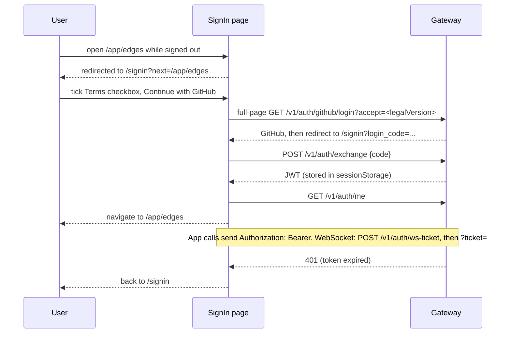

# Studio

React 19 + Vite 7 + Fluent UI v9 + React Flow, TypeScript. Static build, deployed to GitHub Pages at `studio.nexusgit.info`.

## Pages

Public pages need no sign-in. The app lives under `/app` and requires it. Route paths are centralised in `src/lib/routes.ts`.

| Route | Component | What it shows |
| --- | --- | --- |
| `/` | `Landing` | Hero, the problem, a four-step overview, three worked examples (crash, absorbed, bypassed), mutation types, verdict glossary, sample workflow, FAQ |
| `/how-it-works` | `HowItWorks` | Contracts, what a run does, mutation types, heuristic vs semantic, verdicts and health, the recovery-rate formula, seeded replay, studio tour |
| `/terms`, `/privacy` | `Terms`, `Privacy` | The legal pages from `terms-and-privacy.nexusgit.info` in an iframe, with an open-in-new-tab fallback |
| `/signin` | `SignIn` | Terms checkbox, **Continue with GitHub**, optional password form, `login_code` / `login_error` handling |
| `/app` | `ContractCanvas` | Agent graph (React Flow), headline metric cards, per-edge health table, fuzzer mode selector, **Run** and **Retest edge** actions; first-run guidance when there are no runs |
| `/app/edges`, `/app/edges/:edgeId` | `PayloadDiffIndex`, `PayloadDiff` | Pick an edge and trace; field-by-field diff of expected contract vs. received payload |
| `/app/events` | `EventLog` | Telemetry backlog from persisted traces plus live frames |
| `/app/report` | `ReportExport` | Choose a run, strategies, title and notes; export a self-contained HTML report |
| `/app/account` | `Account` | GitHub profile, session (signed-in and expiry, sign out), preferences (theme, default fuzzer mode), accepted Terms version |

Old paths (`/edges`, `/events`, `/report`) redirect into `/app`; unknown paths redirect to `/`. Pages are lazy-loaded. `BrowserRouter` is used, so the deploy workflow copies `index.html` to `404.html` to make deep links work on GitHub Pages.

The layout is split in two: `PublicShell` (header with How it works, Terms, Privacy and Sign in or Open app, footer with legal links) wraps the public routes, and `RequireAuth` then `TelemetryProvider` then `AppShell` wraps `/app/*`. The telemetry WebSocket therefore only opens for signed-in app pages.

## Structure

| Path | Role |
| --- | --- |
| `src/api/client.ts` | `fetch` wrapper, bearer header, 401 handling, WebSocket opening, `login`, `fetchAuthStatus`, `fetchMe`, `exchangeLoginCode`, `githubLoginUrl` |
| `src/api/auth.ts` | `sessionStorage` token helpers and the `gateway:auth-expired` event |
| `src/api/index.ts` | Exports the active `ApiClient` (`liveClient`) |
| `src/hooks/AuthContext.tsx` | `AuthProvider` / `useAuth`: gateway auth status, current user (`/v1/auth/me`), `completeSignIn`, `signOut` |
| `src/components/RequireAuth.tsx` | Redirects signed-out visitors to `/signin?next=<path>` |
| `src/components/PublicShell.tsx`, `PublicBits.tsx` | Public layout and shared section, card and code-block pieces |
| `src/content/explainer.ts` | Mutation types, verdicts, sample edges, examples and FAQ shared by the landing and How it works pages |
| `src/lib/routes.ts` | Route constants, legal URLs, `safeNext` |
| `src/lib/prefs.ts` | Browser preferences (`app-prefs` in `localStorage`) |
| `src/hooks/useTelemetrySocket.ts` | WebSocket lifecycle, reconnect, run state, trace and event accumulation |
| `src/hooks/TelemetryContext.tsx` | Shares one socket state with all app pages |
| `src/hooks/useAsync.ts` | Small loading/error/ready state helper |
| `src/hooks/useDocumentTitle.ts` | Per-page `<title>` |
| `src/lib/metrics.ts` | Edge health, per-edge summaries, run metrics |
| `src/lib/diff.ts` | `buildDiffRows` |
| `src/lib/events.ts` | `frameToEvent` mapping telemetry frames to log rows |
| `src/lib/exportReport.ts` | HTML report generator |
| `src/lib/topology.ts` | Static copy of agents and edges |

## Gateway URL

`VITE_GATEWAY_URL` is read at **build time**. When empty, the studio uses same-origin URLs and the Vite dev server proxies `/health` and `/v1` (including WebSocket) to `GATEWAY_PROXY_URL` (default `http://localhost:8000`). The WebSocket URL is the HTTP origin with `http` replaced by `ws`, so `https://` becomes `wss://`.

## Authentication flow

`AuthProvider` asks the gateway for `/v1/auth/status` (which also reports the current `legalVersion` and the enabled `methods`) and, when a token exists, for `/v1/auth/me`. The sign-in card shows **Continue with GitHub** when GitHub is configured and a password form when `AUTH_PASSWORD` is set, and both stay disabled until the Terms checkbox is ticked. The `next` path is validated by `safeNext` (only `/app...` paths, never an external URL) and kept in `sessionStorage` across the GitHub redirect. On return the page removes `login_code` / `login_error` from the URL, exchanges the code once (guarded so React StrictMode cannot spend it twice) and shows a message for `login_error` values (`state`, `denied`, `github`, `not_allowed`, `terms`, `server`).

The token lives in `sessionStorage`, so it is cleared when the tab closes. Any 401 on an authenticated request clears it and sends the visitor back to sign-in. Signing out only removes the token from the browser.

## Live telemetry

`useTelemetrySocket` opens the socket once and reconnects with a growing delay (see [math.md](math.md#reconnect-backoff)). It merges persisted history (`api.listRecentEvents`) with live events and removes duplicates by event id. Frame handling:

- `RUN_STARTED`: set the active run, clear live traces, mark running.
- `TRACE_EMITTED`: prepend the trace (newest first).
- `RUN_COMPLETED`: stop running, bump `completedRuns` so views refetch persisted data.
- `ERROR`: stop running and surface the message.

## Payload diff

`buildDiffRows(edge, trace)` compares the contract fields with the delivered payload:

| Result | Condition |
| --- | --- |
| `Match` | field present and not named by any violation |
| `Mismatch` | field present and a violation path starts with it |
| `Missing` | contract field absent from the delivered payload |
| `Injected` | key present that is not in the contract (shown as `not allowed`) |

Violation paths are reduced to their first segment (`fields.0` counts against `fields`).

## Report export

`buildReportHtml` produces one HTML file with inline CSS and JS. Serialised data is embedded in a `<script>` with `<` escaped to `\u003c` and U+2028/2029 removed, and all text fields are HTML-escaped, so payload contents cannot inject markup. The report has summary cards, filter buttons (All, Violations, Breaches) and expandable original-vs-delivered payload panes.

## Tests

`npm test` runs Vitest on `src/tests/metrics.test.ts` (edge classification and per-edge aggregation).
